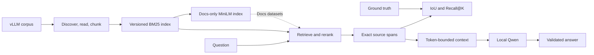

*This project has been created as part of the 42 curriculum by mlagutin.*

# RAG against the machine

## Description

This project is a fully local Retrieval-Augmented Generation (RAG) system for
questions about the vLLM codebase. It reads and chunks the supplied corpus,
builds a deterministic BM25 index and a documentation-only semantic index,
retrieves exact source locations, and can give that evidence to
`Qwen/Qwen3-0.6B` for a grounded answer.

The required workflow is CPU-compatible and uses no external API; the two
local models are downloaded from Hugging Face once and then read from the
cache. Retrieval is measured independently from generation, persisted
artifacts are validated before reuse, and generated data remains outside Git.

| Capability | Implementation |
| --- | --- |
| Required retrieval | Custom two-field BM25 with bounded reranking |
| Docs dataset retrieval | BM25 fused with documentation-only MiniLM embeddings (weighted Reciprocal Rank Fusion) |
| Code dataset retrieval | BM25 only |
| Answer generation | Local `Qwen/Qwen3-0.6B` |
| Source traceability | Project-relative paths and exact character ranges |
| Semantic model | Pinned CPU `sentence-transformers/all-MiniLM-L6-v2` |
| Interfaces | Python Fire CLI and optional local FastAPI server |

## Instructions

Requirements: Python 3.10 or later, `uv`, the supplied vLLM corpus, and the
question datasets.

Install the locked environment:

```bash
make install
```

The Makefile keeps large uv, Hugging Face, and virtual-environment files under
`~/goinfre`, which is suitable for 42 campus storage limits.

Prepare only the input directories needed during evaluation:

```bash
scripts/prepare_evaluation_inputs.sh
```

Place evaluator-provided files as follows:

```text
data/
├── raw/
│   └── vllm-*/
└── datasets/
    ├── AnsweredQuestions/
    │   ├── dataset_docs_public.json
    │   └── dataset_code_public.json
    └── UnansweredQuestions/
        ├── dataset_docs_public.json
        └── dataset_code_public.json
```

`data/processed/` and `data/output/` are created by project commands. Datasets,
indexes, model files, reports, and generated answers are ignored by Git.

### Models, downloads, and cache

Model weights are never committed. On the first run, `index` downloads the
pinned MiniLM embedding model (about 90 MB) and `answer` downloads
`Qwen/Qwen3-0.6B`; later runs read them from the Hugging Face cache
(`~/.cache/huggingface`, or `HF_HOME`, which the Makefile places under
`~/goinfre`). If the embedding model cannot be loaded, for example without
network access and without a cached copy, `index` still builds the BM25 index,
prints a warning, and Docs searches fall back to BM25 only.

### Development commands

```bash
make run          # show the CLI
make debug        # run the CLI through pdb
make test         # run pytest
make lint         # assignment lint configuration
make lint-strict  # flake8 and strict mypy
make clean        # remove local Python check caches
```

## Example Usage

Build the indexes:

```bash
uv run python -m src index --max_chunk_size 2000
```

`index` writes the BM25 index to `data/processed/bm25-index.json` and then the
documentation-only semantic index to `data/processed/semantic-index/`. Its
output reports `semantic_index: unavailable` when the embedding model could not
be loaded; the BM25 index is complete in either case.

Search one question:

```bash
uv run python -m src search "How does prefix caching work?" --k 5
```

Search a complete dataset:

```bash
uv run python -m src search_dataset \
  --dataset_path data/datasets/UnansweredQuestions/dataset_docs_public.json \
  --k 10 \
  --save_directory data/output/search_results/UnansweredQuestions
```

`search_dataset` chooses its retrieval strategy with `--retrieval_mode`
(default `auto`):

| Mode | Strategy |
| --- | --- |
| `auto` | Hybrid when the dataset file name contains the token `docs` (and not `code`), for example `dataset_docs_public.json`; BM25 only for every other name, including `dataset_code_public.json` and unknown names |
| `bm25` | BM25 only |
| `hybrid` | BM25 fused with the documentation semantic index |

`auto` inspects only the file name, never directories or question text. Hybrid
falls back to BM25, with a warning, when the semantic index or its model is
unavailable. The single-query `search` and `answer` commands always use BM25.

Evaluate persisted results locally:

```bash
uv run python -m src evaluate \
  --student_search_results_path \
    data/output/search_results/UnansweredQuestions/dataset_docs_public.json \
  --dataset_path \
    data/datasets/AnsweredQuestions/dataset_docs_public.json
```

The official moulinette receives the student results first and ground truth
second:

```bash
./moulinette evaluate_student_search_results \
  data/output/search_results/UnansweredQuestions/dataset_docs_public.json \
  data/datasets/AnsweredQuestions/dataset_docs_public.json \
  --k 10 \
  --max_context_length 2000
```

Generate one answer or a complete answer dataset:

```bash
uv run python -m src answer "How does prefix caching work?" --k 5 --device auto

uv run python -m src answer_dataset \
  --student_search_results_path \
    data/output/search_results/UnansweredQuestions/dataset_docs_public.json \
  --save_directory \
    data/output/search_results_and_answer/UnansweredQuestions \
  --device auto
```

Use `--offline` after the model is cached. CPU works on campus machines; CUDA
is selected only when explicitly available.

## System Architecture



The CLI and HTTP API are public adapters. Workflows coordinate independently
tested ingestion, retrieval, evaluation, and generation components. Stored
indexes bind together a schema version, corpus fingerprint, pipeline
fingerprint, and snapshot checksum; the semantic index stores the same corpus
and pipeline fingerprints as the BM25 index it was built from and is rejected
when they differ.

Detailed component and sequence diagrams are in
[`docs/architecture.md`](docs/architecture.md).

## Chunking Strategy

All chunks preserve exact source text, project-relative paths, and half-open
`[start, end)` character ranges. The configured maximum is validated and never
exceeds the assignment limit of 2000 characters.

- **Python:** AST-aware boundaries preserve modules, classes, methods, and
  functions. Oversized structures use safe recursive or line-based fallbacks.
- **Markdown and text:** a file that fits within the maximum chunk size stays
  one chunk, so a short page keeps its title and body together. Longer files
  are split at headings, paragraphs, lists, and fenced blocks, with bounded
  overlap only inside oversized blocks.
- **Ranking metadata:** section paths and identifiers are indexed separately;
  synthetic terms never change the evidence text returned to the evaluator.

Unreadable, unsafe, binary, unsupported, or oversized files are rejected by
the discovery boundary. A chunk audit verifies deterministic output, valid
ranges, size limits, non-empty content, and source-slice equality.

## Retrieval Method

The mandatory retriever is a custom BM25 inverted index with separate content
and metadata fields (path, section headings, and Python symbols), rare-term
IDF, document-length normalization, and deterministic tie-breaking. A bounded
auxiliary-path penalty halves the score of `tests/` and `examples/` paths
among the top 20 candidates without excluding them.

- **Metadata function words:** question words such as *what*, *how*, and *are*
  are ignored in the short metadata field, so question-shaped headings do not
  outrank relevant content. Content scoring still uses every query term.
- **Identifier parts:** queries split identifiers into parts (`vLLM` →
  `vllm`, `v`, `llm`; `scaled_mm` → `scaled_mm`, `scaled`, `mm`). Python
  content and metadata already contained these parts; documentation and other
  text content now receive the same parts, so an identifier written in
  documentation matches the query the same way as in code.
- **Original lengths:** for text content, BM25 length normalization counts the
  original words only. The added identifier parts improve matching without
  making a chunk look longer.

`search_dataset` routes Docs datasets to hybrid retrieval and keeps Code on
BM25 (see [Example Usage](#example-usage)). Hybrid retrieval fuses the top 20
BM25 candidates with the top 20 semantic candidates by weighted Reciprocal Rank
Fusion: lexical weight 10, semantic weight 1, rank constant 60. With these
weights, semantic ranks reorder BM25 candidates rather than introduce
unrelated chunks. The semantic index embeds only documentation and other text
chunks, never Python code.

Search returns at most `k` ranked `Source` objects. Evaluation matches a result
only when its path equals the reference path and source-span IoU is at least
0.05. Results are joined to ground truth by `question_id`; missing, unrelated,
duplicate, or question-text-mismatched records are rejected.

BM25 remains the core retriever because it outperformed semantic-only
retrieval on this corpus, especially for exact code identifiers. Experiments
and parameter choices are recorded in
[`docs/bm25-tuning-log.md`](docs/bm25-tuning-log.md).

## Grounded Answer Generation

Retrieved locations are read from the corpus, deduplicated, labelled as
sources, and added whole while they fit the context token budget. Qwen is
loaded once per process and reused for batch generation. The CLI `answer`,
`answer_dataset`, and the API `/answer` share one deterministic citation
policy: `[Source N]` labels are optional, but a label that refers to a source
outside the prompt becomes a controlled error rather than an unverified
answer. The exact insufficient-context reply is always accepted.

The small mandatory model has known reasoning limits. The project guarantees a
traceable evidence path and controlled behavior, not perfect prose.

## Optional Bonuses

All bonuses keep the required BM25 retriever and run on CPU-only machines:

1. **Semantic embeddings:** MiniLM encodes exact chunks into a checksum-linked
   vector index. `index` builds it for documentation and text chunks only.
   The separate `index_semantic` command keeps its original behavior and
   encodes **all** chunks, including Python code.
2. **Hybrid retrieval:** weighted RRF combines lexical and semantic ranks.
   `search_dataset` uses it automatically for Docs datasets; Code stays on the
   stronger BM25 path. `search_dataset_hybrid` and `search_semantic` remain
   available as explicit commands.
3. **Incremental indexing:** unchanged files reuse trusted lexical documents;
   final BM25 statistics are rebuilt from the current corpus. The
   documentation semantic index is re-encoded in full on every `index` run.
4. **Caching:** search and validated-answer caches use complete compatibility
   identities and atomic replacement.
5. **Local HTTP API:** FastAPI reuses one loaded index and lazily loads one
   shared generation backend with thread-safe initialization.

`index` and `index_semantic` write to the same default directory,
`data/processed/semantic-index/`, so the most recent of the two determines its
contents. After `index_semantic`, Docs hybrid searches use embeddings of all
chunks; run `index` again to restore the documentation-only index used by the
default workflow. Pass `--semantic_index_directory` to keep both.

Run the optional API:

```bash
uv run uvicorn 'src.api:create_app' --factory --host 127.0.0.1 --port 8000
```

## Performance Analysis

Measurements below were reproduced on the development Linux machine. Recall
values are measured on the public datasets shipped with the assignment
(100 Docs and 99 Code questions). Timing depends on hardware; the assignment
limits are the acceptance criteria.

| Measure | Result | Required limit |
| --- | ---: | ---: |
| Full index: 20,027 BM25 documents and 1,452 semantic chunks, cached model | 53.6 s | at most 300 s |
| Full index with an empty model cache (includes the MiniLM download) | 71.7 s | at most 300 s |
| `search_dataset` for both datasets (199 questions) | 25.2 s | at most 90 s for 200 |
| Docs Recall@5 / Recall@10 / MRR, default hybrid | 0.880000 / 0.930000 / 0.749274 | Recall@5 >= 0.80 |
| Docs Recall@5 / Recall@10 / MRR, `--retrieval_mode bm25` | 0.890000 / 0.920000 / 0.738500 | comparison |
| Code Recall@5 / Recall@10 / MRR, BM25 | 0.787879 / 0.848485 / 0.645174 | Recall@5 >= 0.50 |
| Incremental reindex, one changed file | 37.6 s (29.3 s semantic re-encoding) | bonus measurement |
| Full automated test suite | 622 passed | all checks pass |

Recall is measured independently for Docs and Code. On the public Docs set,
hybrid retrieval places more references first (Recall@1 0.65 against 0.63),
raises Recall@10 and MRR, and lowers Recall@5 by one question compared with
BM25 alone; Code results are identical in both modes. MRR and Recall@1/3/5/10
are available through `evaluate` and `evaluate_all`; the external moulinette
remains the official evaluator.

## Design Decisions

- **Custom BM25:** exposes tokenization, scoring, persistence, and deterministic
  behavior; experiments cross-checked it against a standard implementation.
- **Exact evidence plus separate metadata:** improves ranking without corrupting
  evaluator-visible source ranges.
- **BM25 as the stable core:** measured better than semantic-only retrieval,
  and it remains the only retriever for Code and single-query commands.
- **Route by dataset, not by question:** the Docs and Code datasets are
  separate inputs with separate thresholds. Routing on the dataset file name
  avoids a question classifier and keeps Code output identical to pure BM25;
  `--retrieval_mode` makes the choice explicit and overridable.
- **Documentation-only embeddings:** encoding only text chunks keeps indexing
  within the time limit on CPU and prevents semantic matches from lifting
  documentation above code in code questions.
- **Fail soft on the optional model:** a missing embedding model only removes
  the hybrid layer; it never prevents indexing or BM25 search.
- **RRF instead of raw-score mixing:** BM25 and cosine scores have incompatible
  scales, while rank positions can be combined safely.
- **One generation attempt:** retries did not show reliable quality improvement
  and doubled model cost.
- **Strict compatibility validation:** stale indexes and caches fail clearly
  instead of producing plausible but incorrect results.
- **Thin adapters:** CLI and HTTP translate errors and presentation while domain
  packages own algorithms.

Reconsidered decisions and rejected experiments are recorded in
[`docs/decision-log.md`](docs/decision-log.md).

## Challenges Faced

- Preserving exact UTF-8 offsets while creating useful structural chunks was
  solved with immutable source slices and format-specific chunkers.
- Broad code questions exposed the limits of lexical matching; identifier and
  path signals improved ranking without changing returned evidence.
- Semantic retrieval helped selected Docs questions but reduced aggregate
  performance when applied universally; hybrid retrieval is therefore scoped to
  Docs datasets.
- Derived terms (identifier parts, word stems) count as extra matches in BM25.
  Adding them to documentation made chunks look longer, and counting one word
  several times distorted ranking; matching on parts while measuring length in
  original words kept the benefit without the length penalty.
- Small-model generation sometimes omitted or invented citations. Requiring a
  label rejected otherwise grounded answers, so labels are optional while
  invented labels are still rejected deterministically.
- Fine-tuning on 100 curated examples produced no material improvement and was
  removed from production rather than retained as unused complexity.
- Incremental and cached artifacts required explicit identity and integrity
  checks to remain equivalent to clean computation.

## Verification

Current checks:

```text
pytest: 622 passed
flake8: passed
mypy with assignment flags: passed for 244 source files
mypy --strict: passed for 244 source files
git diff --check: passed
```

Expected third-party deprecation warnings currently come from Starlette's
AnyIO compatibility alias and Python Fire's coroutine inspection.

## Further Technical Evidence

- [`docs/architecture.md`](docs/architecture.md) — component boundaries and
  indexing, retrieval, generation, persistence, and bonus flows.
- [`docs/decision-log.md`](docs/decision-log.md) — reconsidered choices,
  measured trade-offs, and rejected alternatives.
- [`docs/end-to-end-run-log.md`](docs/end-to-end-run-log.md) — complete
  acceptance commands, timings, memory, retrieval scores, and Qwen findings.
- [`docs/answer-quality-checklist.md`](docs/answer-quality-checklist.md) —
  grounded-answer review criteria and diagnostic procedure.
- [`docs/bm25-tuning-log.md`](docs/bm25-tuning-log.md) — BM25, semantic, and
  hybrid experiments with their measured outcomes.

## Resources

- [Python `ast` documentation](https://docs.python.org/3/library/ast.html)
- [Pydantic documentation](https://docs.pydantic.dev/)
- [Python Fire documentation](https://google.github.io/python-fire/)
- [Hugging Face Transformers documentation](https://huggingface.co/docs/transformers/)
- [Qwen3-0.6B model card](https://huggingface.co/Qwen/Qwen3-0.6B)
- [Sentence Transformers documentation](https://www.sbert.net/)
- [FastAPI documentation](https://fastapi.tiangolo.com/)
- [Robertson and Zaragoza, *The Probabilistic Relevance Framework: BM25 and Beyond*](https://www.staff.city.ac.uk/~sbrp622/papers/foundations_bm25_review.pdf)
- [Cormack, Clarke, and Buettcher, *Reciprocal Rank Fusion Outperforms Condorcet and Individual Rank Learning Methods*](https://plg.uwaterloo.ca/~gvcormac/cormacksigir09-rrf.pdf)

### AI Usage

AI assisted with architecture discussion, test-case brainstorming,
documentation editing, and reviewing implementation alternatives. All
production behavior, measurements, source locations, and commands were checked
locally. AI-generated suggestions were accepted only after tests, lint, and
manual review; AI is not used at runtime except for the required local Qwen
generation model.

## License

This project is available under the [MIT License](LICENSE).
